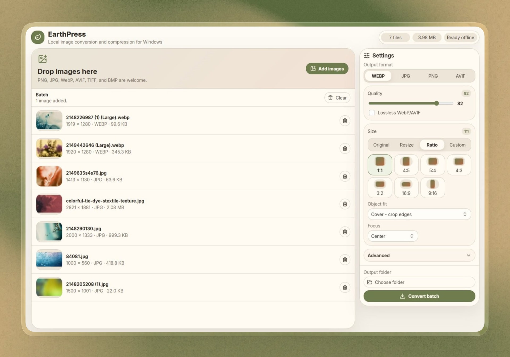

# EarthPress

**Local image conversion and compression for Windows.** Fast, offline, and free of subscriptions or upload limits.

## Why EarthPress

Most online image converters upload your files to someone else's server, throttle you after a few images, or bury the useful options behind a paywall. EarthPress runs entirely on your machine — nothing leaves your computer, batches aren't capped, and it works without an internet connection.

## Features

- **Batch conversion** — drag and drop or add a whole folder of images at once
- **Format support** — convert to/from PNG, JPG, WebP, and AVIF (plus TIFF and BMP as input)
- **Quality control** — adjustable quality slider, or a lossless mode for WebP/AVIF
- **Crop & resize** — Original, Resize, Ratio, or Custom size modes
  - Common aspect ratio presets (1:1, 4:5, 5:4, 4:3, 3:2, 16:9, 9:16) with visual previews
  - Object fit modes: Cover, Contain, Fill, Inside, Outside
  - Focus/anchor control for crops (center, smart detection, or edges)
- **Advanced options** — metadata handling, filename suffixes, overwrite protection, tucked away in a collapsible panel so the main UI stays simple
- **Per-image actions** — jump straight to a converted file with a "Show in folder" button
- **Offline-first** — no accounts, no cloud processing, no telemetry
- **Custom output folder** with a persistent, always-visible Convert button

## Installation

1. Go to the [Releases](https://github.com/immehedy-flow/earthpress/releases) page and download the latest `EarthPress-x.x.x-Setup.exe`
2. Run the installer
   - Windows SmartScreen may flag it since the installer isn't code-signed yet — click **More info → Run anyway**
3. Launch EarthPress and start converting

## Usage

1. Drop images into the app or click **Add images**
2. Pick your output format (WebP, JPG, PNG, or AVIF) and quality
3. Optionally set a crop/resize mode under **Size**
4. Choose an output folder
5. Click **Convert batch**

## Release Notes

Full version history and changelog: [documentation/RELEASE_NOTES.md](documentation/RELEASE_NOTES.md)

## Roadmap / Ideas

- Code-signed installer to remove the SmartScreen warning
- macOS and Linux builds
- CLI mode for scripted/batch workflows
- Additional format support (HEIC input)

Have a feature request? Open an issue — suggestions are welcome even if you're not ready to submit code.

## Contributing

Contributions are welcome, whether that's code, bug reports, UX feedback, or documentation improvements. See [CONTRIBUTING.md](CONTRIBUTING.md) to get started.

## Tech Stack

Built with Electron.

## License

MIT — see [LICENSE](LICENSE) for the full text.

## Author

Created by [Mehedy Hasan](https://immehedy.com)
