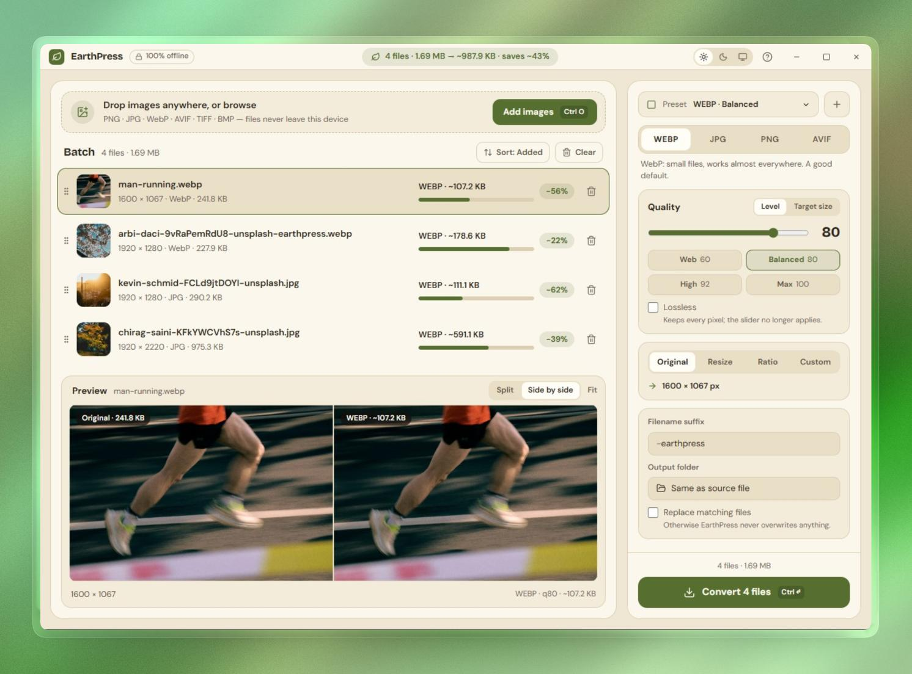

# EarthPress

A warm, fully offline image converter and compressor for Windows.

EarthPress converts images between **WebP, JPG, PNG and AVIF**, with resizing,
aspect-ratio presets, object-fit modes, smart cropping, presets, drag-and-drop
batching and per-image progress. Nothing is uploaded anywhere and no network
connection is required.

This is the **Tauri v2 + Rust** build, rewritten in 2.0.0 and hardened in
2.1.0. The interface centres on a before/after split preview, live size
estimates on every row and a byte-target mode; the image pipeline underneath is
still pure Rust.



---

## Requirements

| Tool | Version used | Notes |
|------|--------------|-------|
| Node.js | 22.x | frontend build only |
| Rust | 1.98+ (built with 1.99) | `x86_64-pc-windows-msvc`. The floor comes from `avif-decode` 3, which is edition 2024. |
| MSVC C++ build tools | VS 2022 Build Tools | provides `link.exe` |
| Windows SDK | 10/11 | provides the import libraries |

Install the Rust prerequisites with:

```powershell
winget install Rustlang.Rustup
winget install Microsoft.VisualStudio.2022.BuildTools --override `
  "--quiet --wait --add Microsoft.VisualStudio.Component.VC.Tools.x86.x64 `
   --add Microsoft.VisualStudio.Component.Windows11SDK.22621"
```

No NASM, `pkg-config`, CMake or C compiler is needed: every image codec here is
pure Rust. Both halves of the AV1 codec (the `ravif`/`rav1e` encoder and the
`rav1d` decoder behind `avif-decode`) are built with their assembly features off,
so nothing shells out to an assembler. See *Vendored patch* below.

## Build

```powershell
npm install          # once
npm run dev          # tauri dev   -> hot-reloading desktop window
npm run build        # tsc -b && vite build (frontend only)
npm run lint         # oxlint src
npm run dist         # tauri build --bundles nsis -> src-tauri/target/release/bundle/nsis
```

Run the Rust suite with `cargo test --manifest-path src-tauri/Cargo.toml`.
GitHub Actions runs the same checks on every push and pull request; see
`.github/workflows/ci.yml`.

`npm run dev` starts Vite on `127.0.0.1:1420` (strict port, matching
`tauri.conf.json`) and then launches the Tauri window against it.

## What's new in 2.1

* **Focused settings** — the Advanced disclosure is gone. Metadata passthrough
  and upscaling are no longer offered, and the fit/crop/background controls now
  live in the Size card where they are relevant.
* **One-line quality presets** — the chips read `Web 60`, `Balanced 80`,
  `High 92`, `Max 100`.
* **Quieter summary** — the post-conversion card no longer has a Copy summary
  button; Open output folder and Undo remain.
* **Hardened webview** — a strict Content Security Policy, narrower Tauri
  capabilities, absolute-path and output-folder validation, and 512 MB /
  100 MP input limits.
* **Atomic writes** — every output is written to a sibling temp file and
  renamed into place, so a crash or full disk cannot truncate a file or destroy
  an original during an overwrite.
* **Better estimates** — two samples per photo (640 px and 960 px) are fitted
  to a `bytes = a · pixels^b` curve instead of a single linear ratio.

## What's new in 2.0

* **Live size estimates** — every row shows what the file will weigh, a mini
  size bar and a savings pill before anything is written.
* **Before/after preview** — the selected image is shown split against the
  encoded result, with a draggable divider, or side by side when a crop changes
  the shape.
* **Target size** — pick a byte target and each file gets the highest quality
  that still fits, found by a short binary search on a sample.
* **Rebuilt interface** — a custom title bar, layered brown surfaces, a
  short `?` shortcut sheet, row states (queued, converting, done, failed, retry)
  and a sticky Convert button.
* **Completion notification** — a Windows toast when a batch finishes while the
  window is in the background.
* **Bundled fonts** — DM Sans and Bricolage Grotesque ship inside the app, so
  the offline claim holds without a network font request.

## Architecture

```
src/                      React frontend (rebuilt for 2.0.0)
  bridge.ts               installs window.earthpress on top of the Tauri IPC
  App.tsx                 app shell, theme, sorting, shortcuts, estimate pump
  components/             TitleBar, AddBar, BatchHeader, ImageList/ImageRow,
                          PreviewCard, SummaryCard, SettingsPanel, ShortcutsSheet
  utils/formats.ts        format metadata, size/option descriptions
src-tauri/src/
  lib.rs                  plugin + command registration
  commands.rs             inspect_files, convert_images, cancel_conversion,
                          preview_pair, estimate_images
  estimate.rs             two-sample cache, size estimates, target search
  pipeline.rs             one file: read -> orient -> decode -> resize -> encode -> atomic write
  inspect.rs              metadata + thumbnail for the list
  parallel.rs             dependency-free 4-worker ordered map
  decode.rs               format sniffing, input limits, AVIF via rav1d, everything else via image
  smartcrop.rs            entropy and attention focus points
  resize.rs               size modes, object-fit modes, padding
  orientation.rs          EXIF orientation baked into pixels
  paths.rs                output naming, sanitising, path validation and reservation
  codecs/                 jpeg.rs, png.rs, quantize.rs, webp.rs, avif.rs
  state.rs                "one batch at a time" slot + cancel flag
  logging.rs              ~/.earthpress/earthpress.log
  vendor/avif-decode/     avif-decode 3.0.0 with rav1d's `asm` feature turned off
```

### How the frontend talks to Rust

Five commands cross the boundary. Everything else the old Electron preload did
(`selectImages`, `selectOutputDir`, `revealPath`) is now handled in JavaScript by
`@tauri-apps/plugin-dialog`, `@tauri-apps/plugin-opener` and
`@tauri-apps/plugin-notification`, so the React components only ever call
`window.earthpress.*` exactly as before.

| `window.earthpress` | Implementation |
|---------------------|----------------|
| `selectImages()` | `plugin-dialog` `open()` + `inspect_files` |
| `inspectFiles(paths)` | `inspect_files` |
| `selectOutputDir()` | `plugin-dialog` `open({ directory: true })` |
| `convertImages(files, options)` | `convert_images` |
| `cancelConversion()` | `cancel_conversion` |
| `previewPair(path, options)` | `preview_pair` |
| `estimateImages(inputs, options)` | `estimate_images` |
| `notifyBatchFinished(title, body)` | `plugin-notification`, skipped while the window is focused |
| `revealPath(path)` | `plugin-opener` `revealItemInDir` |
| `onConversionProgress(cb)` | `listen('convert-progress')` |
| `subscribeDragDrop({onDrop,onHover})` | `getCurrentWindow().onDragDropEvent` |
| `setNativeTheme(theme)` | `getCurrentWindow().setTheme` |

Conversion progress is emitted from Rust on the `convert-progress` event with
`{ id, name, progress }` at 5 / 25 / 45 / 60 / 85 / 100 percent.

## Output rules

* **Output folder** — leave it empty and each converted file is written *next to
  its source*. Set a folder and everything lands there instead. (The Electron
  build required a folder to be chosen.)
* **Filename** — `<original stem><suffix>.<ext>`; the default suffix is
  `-earthpress`. The suffix is sanitised against Windows' illegal characters,
  excess dots are collapsed and it is capped at 100 characters.
* **Collisions** — without *Overwrite* an existing file becomes `name-1.ext`,
  `name-2.ext`, and so on. Parallel workers reserve their path under a lock, so
  two files never race for the same name.
* **Background** — `contain` letterboxing and transparent sources are flattened
  onto the configured colour, default `#fffaf2`.

## Documented differences from the Electron build

These are intentional, and mostly follow from dropping `sharp`/libvips:

| Area | Difference |
|------|------------|
| JPEG | `mozjpeg` trellis quantisation is not available, so files are roughly 5-15% larger at the same quality. Progressive encoding, optimised Huffman tables and 4:2:0 subsampling are all preserved. |
| PNG compression | The `png` crate exposes three levels, so the 0-9 slider maps 0-3 → Fast, 4-7 → Default, 8-9 → Best. Row-adaptive filtering is on. |
| PNG palette | Produced by a hand-written median-cut quantiser (`codecs/quantize.rs`) with no dithering; flat art and logos quantise cleanly. |
| Size estimates | Two samples (640 px and 960 px) are encoded with the real settings, fitted to `bytes = a · pixels^b`, then extrapolated to the output size. This captures the sub-linear growth a single pixel-ratio misses; expect a 10-20 % spread, and treat it as a guide rather than a promise. A cached pair of samples makes later passes cheap, so the numbers keep up with the sliders. |
| Target size | The quality is found by a seven-step binary search on the 640 px sample, then the whole file is encoded once at the winner. A result can land slightly over its target; when even quality 1 cannot fit, the settings card says so instead of pretending. |
| AVIF encoding | rav1e rather than libaom, with assembly disabled, so encoding is slower. Speed 6 is used. |
| AVIF "lossless" | rav1e exposes no bit-exact lossless mode, so lossless falls back to quality 100 (visually lossless, not bit-exact) and logs a warning. |
| Metadata | EXIF/ICC passthrough was removed in 2.1 along with the Advanced controls. EXIF orientation is still read and baked into the pixels, so rotated phone photos come out upright. |
| Input limits | Files over 512 MB and images whose header advertises more than 100 megapixels are rejected before decode. This keeps a crafted or accidental giant from exhausting memory across the four workers. |
| Writes | Outputs are written to a `.earthpress-<pid>-<n>.tmp` file in the destination folder and renamed into place. A crash or full disk cannot leave a truncated output, and an overwrite does not touch the original until the new bytes are complete. |
| AVIF decoding | `rav1d` runs without its assembly kernels, because enabling them would require NASM at build time. Decoding is therefore slower than the Electron build's libaom/dav1d path. |
| `attention` crop | A saliency *approximation* (edge energy + local contrast + colourfulness + centre bias), not a port of libvips' saliency model. `entropy` is a truer port (Shannon entropy of the luma histogram). |
| Animated images | Only the first frame is converted. |
| Thumbnails | JPEG data URIs on `#fffaf2` instead of WebP. |
| Drag-to-reorder | Driven by pointer events on the grip handle instead of HTML5 drag and drop. Tauri replaces WebView2's drop handler so it can deliver real absolute paths from an OS drop, and that disables HTML5 drag and drop on Windows entirely. Pointer events are unaffected, so the gesture is unchanged for the user. |
| Keyboard | Delete and Ctrl+D both clear the workspace. The 1.3.0 hook bound `delete` but only `ctrl+d` was registered, leaving the Delete key dead; both are now wired up. |
| Logger | `~/.earthpress/earthpress.log` instead of Electron's userData folder. |

## Vendored patch

`src-tauri/vendor/avif-decode/` is a verbatim copy of `avif-decode` 3.0.0 with a
single change: on x86/x86_64 it depends on `rav1d` with `default-features = false`
instead of the defaults, and `rav1d`'s default feature list starts with `asm`.

That one word is the difference between a pure-Rust build and one that needs
NASM on every machine, because `rav1d`'s build script invokes the assembler when
`asm` is on. `rav1d` is a Rust port of dav1d and has Rust fallbacks for every
routine the assembly replaces, and upstream `avif-decode` already takes exactly
this route for non-x86 targets (their comment: *"rav1d failed to bundle required
aarch64 asm headers"*). This copy simply extends it to x86.

It is wired up with `[patch.crates-io]` in `src-tauri/Cargo.toml`. Cargo features
are additive, so there is no way to switch `asm` back off from this crate's own
manifest while `avif-decode` asks for it — hence the fork.

**If you bump `avif-decode`**, re-apply the same one-line change to the new
version in the vendored directory (or drop the patch if upstream ever defaults
`rav1d` to `default-features = false`). Everything else in `vendor/` is
byte-for-byte upstream.

## Licence

EarthPress is MIT licensed (see `LICENSE`). Every dependency is permissively
licensed:

* `image`, `png`, `zenwebp` — MIT OR Apache-2.0
* `ravif`, `avif-decode` — BSD-3-Clause
* `rav1e`, `rav1d`, `kamadak-exif` — BSD-2-Clause
* `jpeg-encoder` — (MIT OR Apache-2.0) AND IJG

> **Do not bump `zenwebp`.** 0.1.x and 0.2.x are MIT OR Apache-2.0, but 0.3.0 and
> every later release are AGPL-3.0-or-commercial (`zenwebp`'s own `Cargo.toml`
> says `AGPL-3.0-or-later`). The pin to `zenwebp = "0.2"` in
> `src-tauri/Cargo.toml` is what keeps this app's licence clean.

The IJG terms are permissive but require the copyright notice to travel with
binary distributions, so the required acknowledgement
(*"This software is based in part on the work of the Independent JPEG Group."*)
and the full licence texts are collected in `THIRD_PARTY_NOTICES.md` and
`licenses/`.

The vendored `avif-decode` copy keeps upstream's BSD-3-Clause licence file
(`src-tauri/vendor/avif-decode/LICENSE`); only the dependency declaration was
changed, not the code.

## Security

EarthPress has no network client, no updater and no remote content. The webview
runs under a strict CSP, the Tauri capabilities are limited to the dialogs,
reveal-in-folder and notifications the UI actually calls, and the Rust command
surface validates paths and input sizes. See `SECURITY.md` for the threat model
and how to report a problem.
